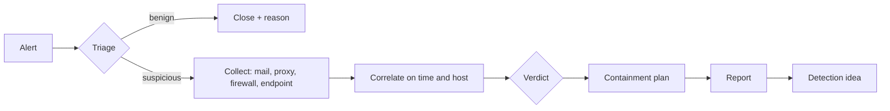
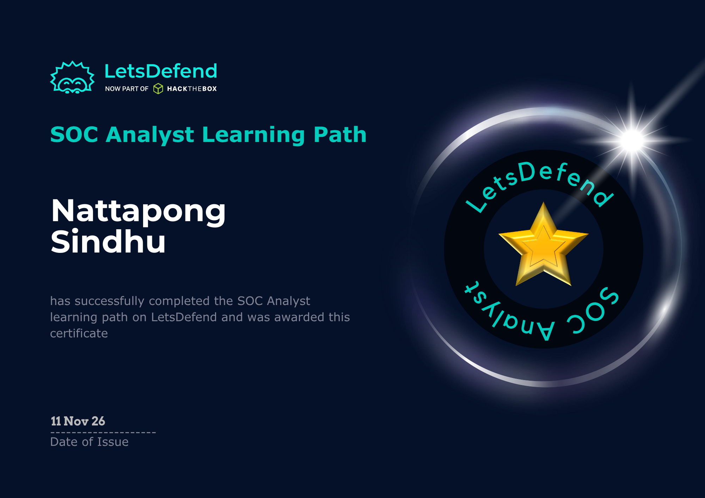

# LetsDefend IT Cybersecurity Portfolio


A study portfolio built from the LetsDefend SOC Analyst Learning Path. This repository documents how I
learned blue-team work: what I studied, what I practised, what I built, and what I would do next.

| | |
| :--- | :--- |
| **Status** | Learning Path complete — 25 of 25 modules · 3 live alert cases closed · 5 case summaries · 1 Python tool · 3 detection rules |
| **Platform** | [LetsDefend](https://letsdefend.io/) — profile [gnopattan](https://app.letsdefend.io/user/gnopattan) |
| **Period** | November – December 2026 |

**Sister portfolio:** [TryHackMe study portfolio](https://github.com/nattapongsindhu/TryHackMe-IT-Cybersecurity-Portfolio)

---

## 1. About This Repository

I built this repository for two reasons.

**First, to show the work.** Anyone can list "SOC Analyst" on a CV. I wanted a place where a recruiter
or a hiring manager can see what I actually did: the paths I finished, the concepts I can explain in my
own words, the alerts I triaged end to end, and the reports I wrote afterwards.

**Second, to keep an honest record.** For every topic I note what I now understand and what I still do
not. Where a lab could not be completed because of platform limits, that is written down instead of
hidden.

### What this repository is not

- It is **not** a walkthrough dump. There are no flags, no room answers, and no copy-paste solutions.
- It is **not** a certificate wall. The certificates page links to real credentials; the value is in the
  evidence behind them.
- It is **not** finished. The "Next Steps" section is part of the point.

### Who this is for

Recruiters and hiring managers looking at entry-level SOC, blue-team, or IT security roles, and anyone
who wants to see how a self-directed learner documents work.

---

## 2. Learning Paths Completed

### LetsDefend — SOC Analyst Learning Path

| Item | Detail |
| :--- | :--- |
| Path | SOC Analyst Learning Path |
| Modules | **25 / 25 completed** |
| Lessons | 160 lessons studied |
| Graded questions | 298 answered |
| Quizzes | 13 passed — 570 points |
| Live alert cases | 3 closed (all True Positive, with written analyst notes) |
| Start | November 2026 |
| Finish | December 2026 |
| Status | **Complete** |

The path is built in a fixed order, from SOC basics to malware analysis and lab building. I worked
through it in that order without skipping modules. The module-by-module breakdown is summarised in
[Study Notes](study-notes/README.md).

---

## 3. Skills Learned

| Skill | Where it came from | What I can do with it |
| :--- | :--- | :--- |
| SOC operations | Modules 1–3, 17 | Explain tier 1 to tier 3 roles, alert lifecycle, and case ownership |
| Alert triage | Modules 4–8, 10, 21 | Read an alert, decide true or false positive, and write the verdict |
| Phishing and email analysis | Module 4, case SOC282 | Read a mail header, check the sender path, judge an attachment |
| Web attack detection | Modules 5–7 | Recognise SQL injection, XSS, command injection, IDOR, LFI/RFI, brute force |
| Log analysis | Modules 15–16, 18 | Read firewall, proxy, VPN, DNS and web logs, and spot the odd row |
| SIEM and Splunk | Modules 16, 18 | Write searches and build simple alerts and dashboards |
| Malware and document analysis | Modules 9–13, 24 | Use a sandbox report, read a macro chain, follow a C2 session |
| Threat intelligence | Modules 19–20 | Check IOCs against VirusTotal and use TI to enrich a case |
| Incident response | Modules 17, 21 | Contain, eradicate, recover, and record the decision |
| Documentation | 5 case summaries and 1 Python tool | Turn an investigation into a report a manager can read |

### What I am not claiming

I have not run an enterprise SOC. The cases here are platform labs and simulated alerts. My EDR access
was limited, so host isolation was a recommendation in my reports, not an action I performed. I say this
because a portfolio that overstates its evidence is worse than a smaller honest one.

---

## 4. Tools and Technologies

| Area | Tools I practised with |
| :--- | :--- |
| Network analysis | Wireshark, tcpdump, Wireshark display filters |
| Reconnaissance and scanning | Nmap, Nikto, dirb (in lab exercises) |
| Log and SIEM | Splunk (search, alerts, dashboards), Kibana-style log views, LetsDefend SIEM |
| Endpoint | EDR console, Sysmon, Windows Event Viewer, Windows event IDs |
| Malware analysis | Any.Run, Hybrid Analysis, VirusTotal, FLOSS-style static checks, oletools |
| Traffic and OSINT | VirusTotal, URLQuery, AbuseIPDB-style lookups, Shodan queries |
| Scripting | Python 3 (log parsing, IOC extraction), Bash, PowerShell |
| Systems | Linux command line, Windows 10/11, VirtualBox, pfSense |
| Documentation | Markdown, Git and GitHub, MITRE ATT&CK mapping |

### Python

I wrote a small log analyser as practical evidence — see
[Python Log Analyzer](practical-evidence/python-log-analyzer/). It is deliberately simple: parse a web
access log, count sources, spot scanner user agents, and surface command-injection style payloads.

---

## 5. Study Notes

My own summaries, written in my words, of the concepts behind each block of the path. These are
explanations, not walkthroughs — no room answers, no flags, no step-by-step solutions to anything still
active.

| Note | Covers |
| :--- | :--- |
| [01 — SOC fundamentals](study-notes/01-soc-fundamentals.md) | SOC tiers, alert lifecycle, SIEM vs EDR vs SOAR |
| [02 — Kill chain and MITRE ATT&CK](study-notes/02-kill-chain-and-mitre.md) | Intrusion phases and how to map evidence to techniques |
| [03 — Phishing and email headers](study-notes/03-phishing-and-email-headers.md) | Header fields, sender path, attachments, lookalike domains |
| [04 — Web attacks](study-notes/04-web-attacks.md) | Injection, XSS, IDOR, traversal, brute force, and what logs show |
| [05 — Malware and document analysis](study-notes/05-malware-and-document-analysis.md) | Static vs dynamic analysis, macro chains, sandbox reports |
| [06 — Logs, SIEM and incident response](study-notes/06-logs-siem-and-incident-response.md) | Log types, search strategy, containment and reporting |

---

## Investigation workflow

Every case in this repository follows the same seven steps. The diagram and the "done" definition for
each step are in [docs/architecture.md](docs/architecture.md).



---

## 6. Practical Evidence

Work I produced myself. Each item is an evidence summary: what the case was, what I did, what the
result was, and what I could not verify.

| # | Evidence | Type | Result |
| :---: | :--- | :--- | :--- |
| 01 | [Phishing investigation](practical-evidence/01-phishing-investigation.md) | Live alert case | True positive, mail lure to stealer C2 |
| 02 | [Web attack analysis](practical-evidence/02-web-attack-analysis.md) | Log analysis challenge | Full attack chain reconstructed from an access log |
| 03 | [Macro document to C2](practical-evidence/03-macro-document-to-c2.md) | Live alert case | True positive, macro to C2 with persistence |
| 04 | [Benign activity review](practical-evidence/04-benign-activity-review.md) | False-positive study | Tuning plan for an alert that fires on internal tests |
| 05 | [Campaign reconstruction](practical-evidence/05-campaign-reconstruction.md) | Multi-host incident | Three hosts, one campaign, two confirmed outcomes |
| 06 | [Python log analyzer](practical-evidence/python-log-analyzer/) | Tool I built | Parses access logs, flags scanners and injection payloads — 9 unit tests, runs in CI |

Every case links back to a full report held in my private working repository. If you are reviewing my
application and want the long version, ask and I will send it.

---

## 7. Certificates and Links

| Item | Link |
| :--- | :--- |
| [LetsDefend](https://letsdefend.io/) profile | [gnopattan](https://app.letsdefend.io/user/gnopattan) — the account the path was completed on |
| TryHackMe profile | [tryhackme.com/p/nattapongsindhu](https://tryhackme.com/p/nattapongsindhu) |
| GitHub | [github.com/nattapongsindhu](https://github.com/nattapongsindhu) |
| LetsDefend certificate | [letsdefend-soc-analyst-path.png](certificates/letsdefend-soc-analyst-path.png) — SOC Analyst Learning Path, issued 11 Nov 2026 |



The LetsDefend certificate is stored in [`certificates/`](certificates/). The two TryHackMe certificate
images are still placeholders.

---

## 8. Lessons Learned

**The technical part was the easy part.** Running a search or reading a log took minutes. Deciding what
"done" means took longer. When the endpoint console could not isolate a host, the honest answer was to
write that limit into the report, not to describe an action I did not take.

**Evidence beats opinion.** In the phishing case, one log row proved the user downloaded the file and
another proved the malware connected out. Two rows moved the case from "suspicious mail" to a confirmed
infection. I now look for the row first and the story second.

**"Allowed" is the most important word in an alert.** A blocked case takes five minutes. An allowed case
turns into a campaign. That single field decides how much of the hour I will spend.

**Writing is part of the job.** A report that a manager cannot read is a report that does not exist. I
rewrote my first report three times, mostly to remove detail that did not change the decision.

**Say what you could not check.** Every report in my private repository has a limits section. It is the
part I am most comfortable defending in an interview, because it is the part that is honest.

---

## 9. Next Steps

| Priority | Goal | Why |
| :---: | :--- | :--- |
| 1 | Build a home SOC lab with real EDR telemetry | My reports stop at "recommend isolation" because I had no EDR access |
| 2 | Study Linux and Python more deeply | Half of incident response happens on the command line |
| 3 | Practise network security and traffic analysis | Wireshark is a skill I want at working level, not demo level |
| 4 | Learn detection engineering | Write and test Sigma rules instead of describing them |
| 5 | Prepare for CompTIA Security+ | Structured coverage of the fundamentals for HR screening |
| 6 | Work through more live alert cases | Volume builds pattern recognition faster than reading |

Longer term I want to specialise in detection and response, with enough engineering skill to automate
the boring parts.

---

## 10. Security and Privacy Check

This repository is public, so it was checked before publishing:

| Check | Status |
| :--- | :--- |
| API keys | None present |
| Passwords or tokens | None present |
| Flags or room answers | None present — study notes are concept summaries only |
| Active-room walkthroughs | None present |
| Personal data (addresses, phone numbers, real names of others) | None present |
| Internal or employer data | None present — all cases are public lab data |
| Hostnames and IPs from labs | Only public lab ranges, kept as evidence context |

The full checklist and the commands I used to scan for secrets are in
[SECURITY-CHECK.md](SECURITY-CHECK.md).

---

## Repository layout

```text
LetsDefend-IT-Cybersecurity-Portfolio/
├── README.md                       this page
├── study-notes/                    concept summaries in my own words
├── practical-evidence/             case summaries and the Python log analyzer
│   └── python-log-analyzer/        tool, sample log, unit tests, sample output
├── detection-engineering/          three rules written from these cases
├── docs/architecture.md            the investigation workflow diagram
├── .github/workflows/ci.yml        tests + secret scan on every push
├── certificates/                   certificate images and credential links
├── SECURITY-CHECK.md               the pre-publish safety checklist
└── CHANGELOG.md                    what changed, when and why
```

---

## Change history

What changed and when: [CHANGELOG.md](CHANGELOG.md).

---

## Note on sources

Everything here is my own writing. The learning content comes from the LetsDefend platform; the
summaries, the analysis, the mistakes and the conclusions are mine. Where a value came from a course
walkthrough rather than my own observation, the evidence summary says so.

---

## License

| Part | License |
| :--- | :--- |
| Code (the Python log analyzer) | **MIT** — see [LICENSE](LICENSE). Use it, change it, ship it. |
| Written content (notes, evidence summaries, this README) | © Nattapong Sindhu. Quote it with attribution; do not republish it as your own. |
| Platform content quoted for context | Belongs to LetsDefend / TryHackMe; used here only as short references |

If you are a recruiter or an interviewer, you do not need permission to read, print or share a link to this
repository. That is what it is for.

