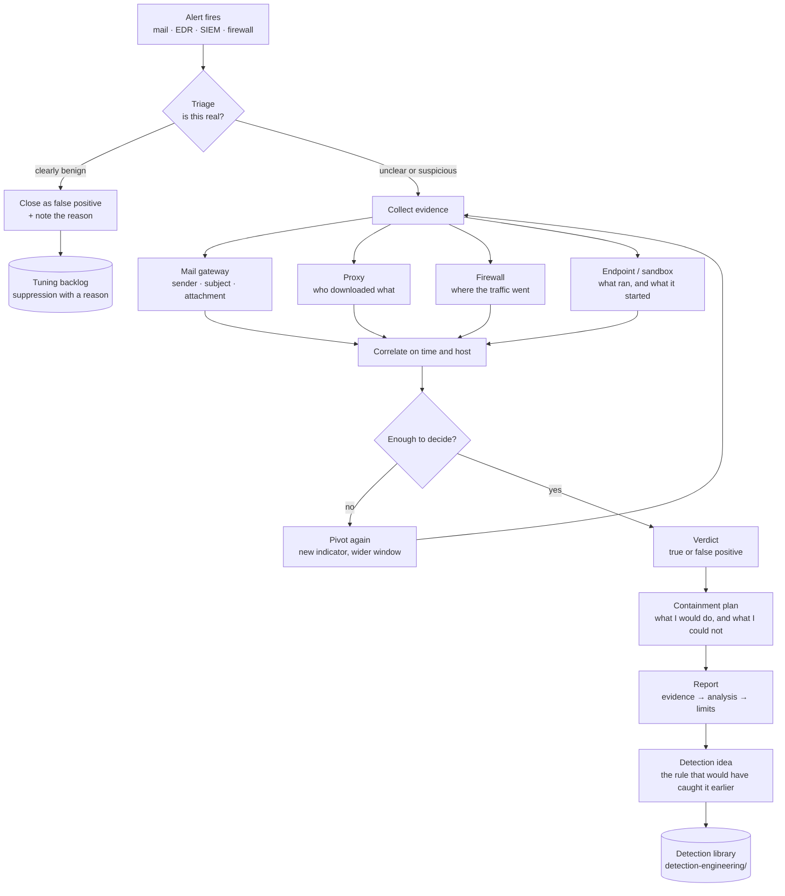

# Investigation Workflow

The same seven steps in every case in this repository. The diagram is not decoration: it is the checklist I
run when an alert looks interesting, and the reason each case file has the same shape.

## The steps, and what "done" means at each one

| Step | Question | Done when |
| :---: | :--- | :--- |
| 1 | What fired, and what does the alert actually claim? | The alert fields are copied into a scratch note |
| 2 | Is this real? | There is a reason for the verdict, not a feeling |
| 3 | What do the logs say? | At least two independent sources agree |
| 4 | Did anything run? | A process, a file or a network session proves execution |
| 5 | How far did it go? | Other hosts or users are checked, not assumed |
| 6 | What do I do about it? | Containment is written even when it cannot be executed |
| 7 | What would catch this faster? | One concrete rule idea, tied to the evidence |

## Why the diagram has two exits at triage

Most workflow diagrams assume every alert is an incident. In practice the important branch is the boring
one: a false positive closed with a written reason is a successful triage, not a wasted hour. Case 04 in
this repository exists to show that branch.

## Where the loop back to collection happens

The arrow from "Enough to decide? no" back to evidence collection is the most used path in real triage. The
first pass almost never answers "how far did it go". A second pivot — usually on the destination address or
a hash — is what turns an alert into a scope.

## What this workflow does not cover

- **Threat hunting.** Everything here starts from an alert. Hunting starts from a hypothesis.
- **Live containment.** The diagram has a containment step, but in this portfolio it produced
  recommendations, not actions, because the console had no endpoint control.
- **Automation.** No SOAR, no playbook automation. The playbooks I walked were human-driven.

Those three are the gaps I would close first in a real SOC.
