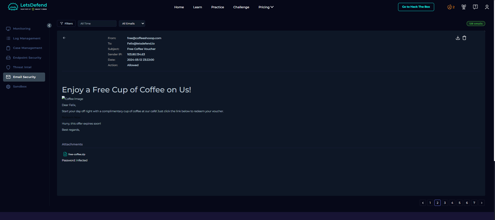
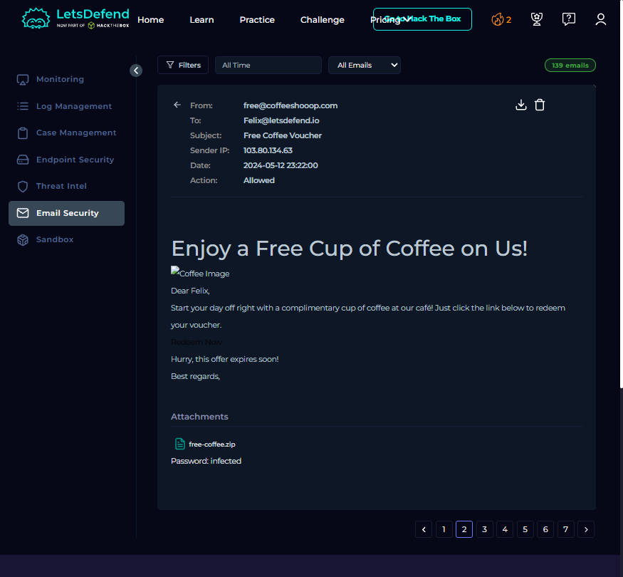

# 01 — Phishing Investigation (Mail Lure to Stealer C2)

**Type:** live alert case · **Platform:** LetsDefend · **Verdict:** True Positive
**Skills:** email header analysis, log correlation, IOC extraction, containment planning

---

## Context

A mail reached a user's mailbox with the subject *Free Coffee Voucher*. It carried a password-protected
zip and a "Redeem Now" link. The mail filter allowed it through. The alert asked a simple question: was
this a real threat, and did anything happen after delivery?

## What I did

1. Read the alert fields: sender, recipient, subject, sender IP, and the device action.
2. Opened the message in the mail console to check the body, the link, and the attachment.
3. Compared the link target and the attachment name. Both pointed at the same file on a public object
   store.
4. Searched the proxy and firewall logs for the recipient's host address.
5. Traced the process that downloaded the file and the process that made the outbound connection.
6. Wrote the verdict, the recommended actions, and the limits into the case note.

## Evidence

| Source | What it showed |
| :--- | :--- |
| Mail gateway | Message delivered from a lookalike domain through a relay IP, action **allowed** |
| Proxy | The user's browser fetched the archive from an object-storage URL |
| Firewall | The dropped binary opened a TCP session to a hosting IP on a non-standard port |
| Endpoint | The dropped binary had several shell children, far more than the application needed |

The mail was the delivery. The proxy row was the download. The firewall row was the compromise. Three
sources, three sentences, one conclusion.

## Result

**True positive.** The chain was: phishing mail, password-protected archive, user execution, malware
beacon to an external host. The case was closed with a written note covering the chain, the indicators,
and the recommended containment.

## Recommended actions I recorded

- Isolate the host from the network.
- Reset the user's credentials and revoke active sessions, because stealers read saved browser data.
- Block the destination IP and the delivery URL at the proxy and at DNS.
- Search mail and proxy logs for the same sender, subject and URL to find other recipients.
- Hunt the binary hash across all endpoints.

I could not perform the isolation myself; the endpoint console available to me listed no hosts. The
report says that in plain words instead of describing an action I did not take.

## Limits

- The mail headers were not fully visible in the interface, so I did not assert SPF, DKIM or DMARC results.
- The process identifiers and hash came from the course walkthrough for this alert; the platform accepted
  those answers, and the network rows above are ones I read myself.
- The log store available to me is a demonstration data set, so the timestamps are historical rather than
  live.

## What I would do differently

I would check the mailbox rules before the endpoint. Attackers who deliver mail often add a hidden
forwarding rule, and that takes thirty seconds to check. I only thought of it after closing the case.

---

## Screenshots

| Image | What it shows |
| :--- | :--- |
|  | The message in the mail console: sender, recipient, subject, sender IP, action allowed |
|  | The body with the "Redeem Now" link and the attachment name |

## Evidence tables

### Timeline

| Time (+03:00) | Event | Source |
| :--- | :--- | :--- |
| 2024-05-12 23:20:33 | Message delivered to the mailbox | Mail gateway |
| 2024-05-13 12:59:44 | User's browser fetched the archive | Proxy |
| 2024-05-13 13:00:39 | Dropped binary opened a session to the internet host | Firewall |
| 2024-05-13 13:00:51 | Same binary tried localhost and was denied | Firewall |
| 2024-05-13 13:01:48 | Second session to the same internet host, allowed | Firewall |

The 13-hour gap between delivery and download is the part most people miss: the mail sat in the inbox
overnight and the user acted the next morning.

### IOCs

| Type | Value | Note |
| :--- | :--- | :--- |
| Domain | `coffeeshooop.com` | Lookalike spelling of a coffee brand |
| Sender | `free@coffeeshooop.com` | External, consumer-style address |
| Delivery URL | `files-ld.s3.us-east-2.amazonaws.com/...-free-coffee.zip` | Public object storage, random prefix |
| File | `free-coffee.zip` → `Coffee.exe` | Password-protected archive |
| SHA-256 | `CD903AD2211CF7D166646D75E57FB866000F4A3B870B5EC759929BE2FD81D334` | Dropped binary |
| Network | `37.120.233.226:3451` TCP | Command and control |
| Host | `172.16.20.151` | Victim workstation |

All values are lab data from the training platform. They are published because they are already public
indicators, not because they belong to anyone.

### MITRE ATT&CK for this case

| Technique | Evidence in this case | Source | Confidence | Detection opportunity |
| :--- | :--- | :--- | :---: | :--- |
| `T1566.002` Spearphishing link | Mail with a link and an archive | Mail gateway | High | Rule on lookalike domains plus password-protected archives |
| `T1204` User execution | User opened the archive and ran the file | Proxy + endpoint evidence | High | Alert on user-downloaded binaries that start child processes |
| `T1059` Command interpreter | Multiple shell children from the dropped binary | Endpoint, via course walkthrough | Medium | Count shell children per parent; 3+ is a signal |
| `T1071` Application layer protocol | Session to `37.120.233.226:3451` | Firewall | High | [Rule 2](../detection-engineering/README.md) — uncommon port |
| `T1027` Obfuscated files (possible) | Password-protected archive bypasses scanning | Alert context | Possible | Score archives that arrive with a password |
## Skills demonstrated

`email header analysis` · `phishing triage` · `proxy and firewall log correlation` · `process lineage
reading` · `IOC extraction` · `containment planning` · `bilingual incident write-up`