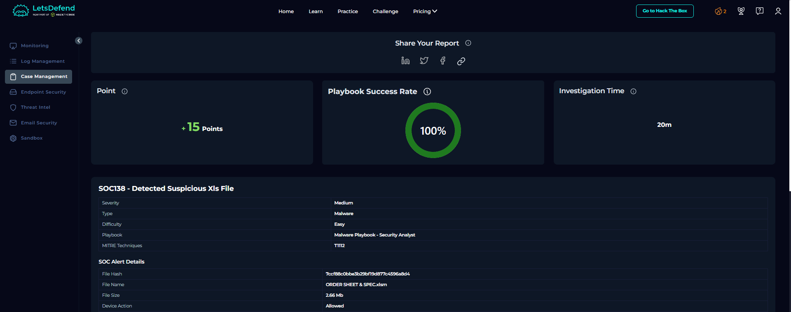

# 03 — Macro Document to C2

**Type:** live alert case · **Platform:** LetsDefend · **Verdict:** True Positive
**Skills:** document analysis, process lineage, C2 identification, persistence analysis

---

## Context

An internal host received a spreadsheet named like a business order sheet. The security stack recorded the
file but did not stop it: the device action was **allowed**. The question was whether the document was
malicious and whether anything ran.

## What I did

1. Read the alert fields: file name, size, hash, host, source address, device action, mapped technique.
2. Confirmed the file type was macro-capable and the name was a business lure.
3. Used a public sandbox report for the same hash to see the behaviour, because my endpoint console showed
   no hosts.
4. Built the execution chain from the sandbox process tree and network tab.
5. Located a second internal host that resolved the same command-and-control domain.
6. Walked the platform playbook to record the verdict and the recommended actions.

## Evidence

| Source | What it showed |
| :--- | :--- |
| Alert pane | Macro-capable workbook, 2.66 MB, allowed, mapped to registry modification |
| Sandbox report | Office process started a script host, which wrote a script file to a temporary folder |
| Sandbox network tab | HTTPS session to a single external host |
| Behaviour | A registry value written for persistence |
| Log search | A second internal host resolving the same C2 domain |

The chain was short: document, macro, script host, dropped script, outbound connection, persistence. Short
chains are the normal case. Malware does not need to be elegant.

## Result

**True positive.** The document ran, the host connected out, and persistence was written. A second host
touched the same infrastructure, which turned a single alert into a campaign — documented separately as
[case 05](05-campaign-reconstruction.md).

## Recommended actions I recorded

- Isolate both hosts.
- Remove the registry run value, not just the dropped file.
- Block the C2 IP and domain at proxy and DNS.
- Block the delivery URL so the same file cannot be fetched again.
- Hunt the hash and the file name across mail and endpoints.
- Disable macros for internet-origin documents by policy.

None of the isolation actions were possible from my console. The report states that as a limitation.

## Limits

- The endpoint console listed no hosts, so I did not observe the process tree on the victim machine myself.
  The chain comes from a public sandbox report of the same hash, and the report names that source.
- I did not re-run the sample in my own lab.
- The log data set is demonstrative, so the timestamps are historical.

## What I learned

The file is not the attack. The attack is what the file starts. I initially focused on the document, and
the interesting evidence was the script host it spawned and the registry value it wrote. Since then I read
the process tree before the file properties.

---

## Screenshots

Case closed with 100 % playbook success, and the alert fields behind the verdict: file hash, file name,
size and device action. The answer panel is cropped out on purpose.

## Evidence tables

### Timeline

| Step | Event | Source |
| :---: | :--- | :--- |
| 1 | Workbook received and opened on the host | Alert pane |
| 2 | Macro runs and starts a script host | Sandbox process tree |
| 3 | Script file written to a temporary folder | Sandbox file activity |
| 4 | HTTPS session to the external host | Sandbox network tab |
| 5 | Registry value written for persistence | Behaviour mapping |
| 6 | Second internal host resolves the same domain | Log search |

### IOCs

| Type | Value | Note |
| :--- | :--- | :--- |
| File | `ORDER SHEET & SPEC.xlsm` | Business-document lure |
| MD5 | `7ccf88c0bbe3b29bf19d877c4596a8d4` | Sample identifier |
| SHA-256 | `7bcd31bd41686c32663c7cabf42b18c50399e3b3b4533fc2ff002d9f2e058813` | Sample identifier |
| Delivery | `files-ld.s3.us-east-2.amazonaws.com/7ccf88c0…zip` | Object storage |
| C2 IP | `177.53.143.89` | External host |
| C2 domain | `multiwaretecnologia.com.br` | Resolved by two hosts |
| Hosts | `172.16.17.56`, `172.16.17.24` | Victim and probable second victim |

### MITRE ATT&CK for this case

| Technique | Evidence in this case | Source | Confidence | Detection opportunity |
| :--- | :--- | :--- | :---: | :--- |
| `T1204` User execution | Document opened, macro enabled | Alert + sandbox | High | [Rule 1](../detection-engineering/README.md) covers the result |
| `T1059` Command interpreter | Script host started by Office | Sandbox process tree | High | Office → script host rule |
| `T1547.001` / `T1112` Registry autostart | Run value written after execution | Behaviour mapping | Medium | Watch registry writes from Office children |
| `T1071` Application layer protocol | HTTPS session to a single external host | Sandbox network tab | High | New-domain or uncommon-port alert |
## Skills demonstrated

`malicious document triage` · `sandbox report reading` · `process lineage analysis` · `C2 identification` ·
`persistence analysis` · `second-victim discovery` · `containment planning`