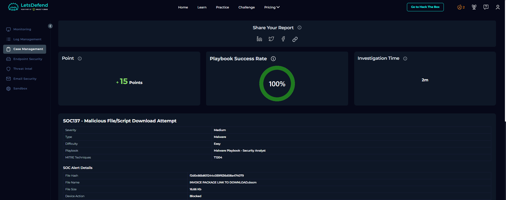

# 05 — Campaign Reconstruction (Three Hosts, Two Evenings)

**Type:** multi-host incident reconstruction · **Cases:** two alerts plus one probable victim
**Verdict:** True Positive — one campaign · **Skills:** correlation, scoping, incident reporting

---

## Context

Two alerts fired on consecutive evenings. Different file names, different file types, same delivery style.
One host executed the payload; the other was blocked at download. A third host appeared during the log
search. The question was whether these were separate incidents or one campaign.

## What I did

1. Put the two alerts side by side: file names, file types, device actions, timestamps.
2. Compared the outbound infrastructure referenced by both.
3. Searched the logs for the command-and-control domain to find other hosts.
4. Built a single timeline across the three hosts.
5. Wrote the incident as one campaign with three outcomes.

## What the comparison showed

| Host | Delivery | Action | Outcome |
| :--- | :--- | :--- | :--- |
| Host A | Order-sheet spreadsheet | Allowed | Executed, C2 contacted, persistence written |
| Host B | Invoice document | Blocked | Stopped at download, nothing ran |
| Host C | Unknown file | Unknown | Resolved the same C2 domain |

Two different file names and two different file types, one delivery pattern and one C2. That is how
commodity campaigns work: rotate the lure, keep the backend.

## Result

**One campaign, three hosts, one confirmed infection.** The blocked host was the only one a control
stopped, which says more about coverage than about the control.

## Why the third host mattered

Host C never appeared in an alert. It appeared because a DNS lookup for the C2 domain showed up in the log
search. A host that talks to the infrastructure is a host worth checking, whether or not a rule fired. That
single row turned a two-host story into a three-host scope.

## Containment plan I recommended

| Step | Action |
| :--- | :--- |
| 1 | Isolate the two reachable hosts |
| 2 | Block the C2 IP and domain at proxy, DNS and firewall |
| 3 | Remove the registry persistence and the dropped script files |
| 4 | Rebuild both hosts and reset user credentials |
| 5 | Sweep the subnet for the hashes and for script hosts spawned by Office |
| 6 | Alert on Office spawning script hosts, and on lookups of newly registered domains |

## Limits

- No endpoint console access, so no live process trees and no executed isolation.
- Host C is inferred from a DNS row, not from a file hash; it stays "probable" in my report.
- The log data set is demonstrative; the 2021 rows were not read line by line.

## What I learned

Two alerts are not two incidents. The moment I compared the infrastructure instead of the file names, the
picture changed. Correlation is the cheapest scoping tool available: no extra sensor, just a second look at
data I already had.

---

## Screenshots

The blocked host in the same campaign, closed with the same report layout. The answer panel is cropped out.

## Evidence tables

### Timeline

| Time (+03:00) | Host | Event |
| :--- | :--- | :--- |
| 2021-03-13 20:20:58 | `172.16.17.56` | Alert fires for the order-sheet workbook |
| 2021-03-13 evening | `172.16.17.56` | Macro runs, script host starts, C2 contacted |
| 2021-03-13 unknown | `172.16.17.24` | DNS lookup for the C2 domain |
| 2021-03-14 19:15:52 | `172.16.17.37` | Alert fires for the invoice document, download blocked |

### IOCs

| Type | Value | Note |
| :--- | :--- | :--- |
| C2 IP | `177.53.143.89` | Shared by both alerts |
| C2 domain | `multiwaretecnologia.com.br` | Shared infrastructure |
| Files | `.xlsm` order sheet, `.docm` invoice | Same delivery style, different lure |
| Hosts | `172.16.17.56`, `172.16.17.37`, `172.16.17.24` | One confirmed infection, one block, one probable |

### MITRE ATT&CK for this case

| Technique | Evidence in this case | Source | Confidence | Detection opportunity |
| :--- | :--- | :--- | :---: | :--- |
| `T1566` Phishing | Two macro documents delivered by mail | Alert records | High | Rule on macro attachments with business names |
| `T1204` User execution | One host executed, one was blocked | Alert device actions | High | Compare allowed versus blocked per campaign |
| `T1071` Application layer protocol | Shared C2 resolved by a third host | Log search | Medium | DNS alert on lookups of new domains |
| `T1112` Registry modification | Persistence written on the infected host | Case 03 behaviour | Medium | Registry monitoring from Office children |
## Skills demonstrated

`alert correlation` · `campaign analysis` · `DNS log pivoting` · `scope definition` ·
`incident report writing` · `containment planning`